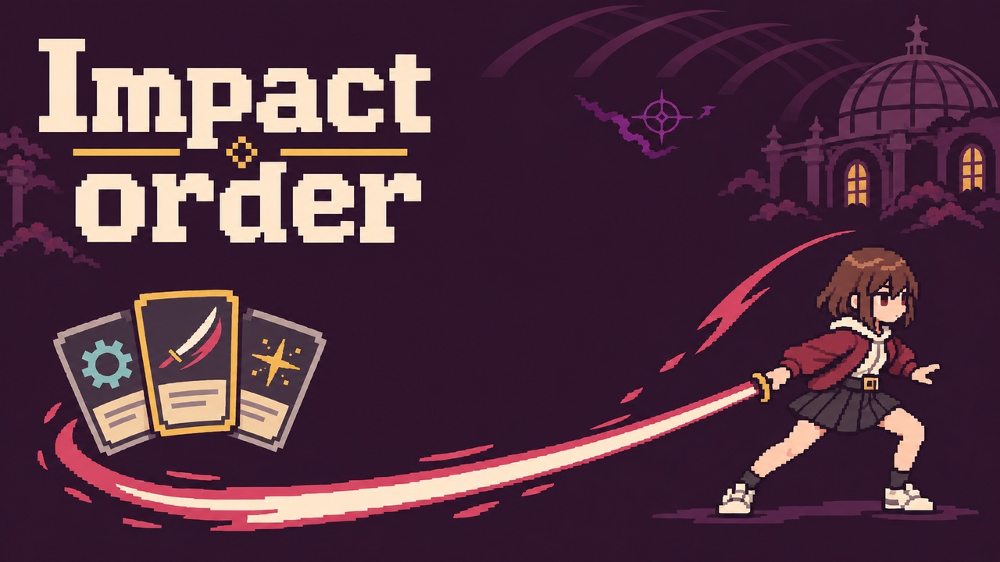
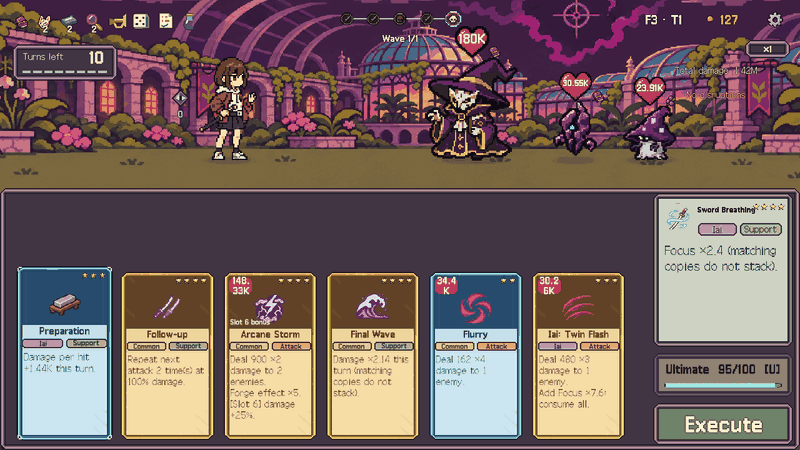
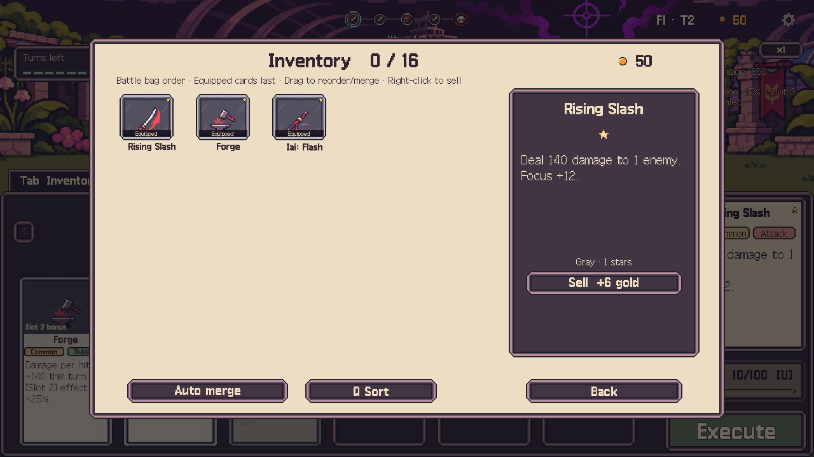
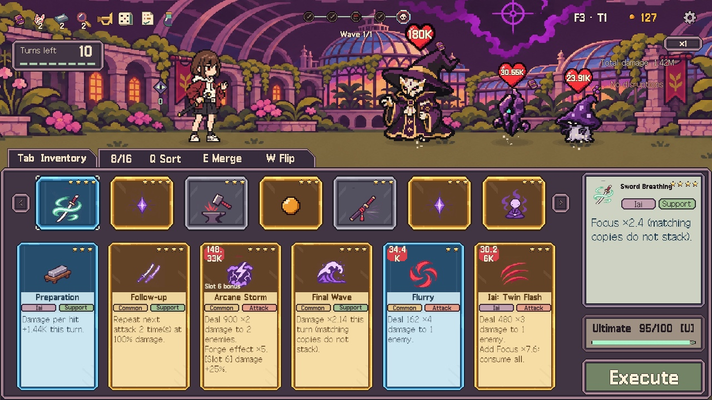

### Set your order. Land the blow.

**Developed with Codex.**

A single-player, turn-based sequence deckbuilder set in the void beneath a magic school. 
Arrange your cards, build Focus, and unleash your Iai strikes before the turn limit runs out.

**Windows · WebGL | English · Korean**

## The game

- **Order matters.** Fill up to six sequence slots; cards execute automatically from left to right.
- **Build the hit.** Combine Focus, flat bonuses, multipliers, and follow-up attacks.
- **Make the slot count.** Place cards in their preferred positions for extra effects, or take a chance on luck-based cards.
- **Grow your collection.** Choose a reward after each wave, merge two matching cards of the same star rank, and upgrade up to four stars.
- **Read the enemy.** Plan around visible enemy actions, card seals, and a strict turn limit.
- **3 floors · 30 battles · 34 cards · 21 items · 12 enemy types + floor bosses.**

  
   
  Actual gameplay · Floor 3 boss battle · 2× playback

## Screenshots

<table>
  <tr>
    <td align="center" width="50%">
       
      Manage your collection and inspect cards.
    </td>
    <td align="center" width="50%">
       
      Prepare your sequence before committing.
    </td>
  </tr>
</table>

## Controls

| Input | Action |
| :--- | :--- |
| Drag a card | Equip, reorder, merge matching cards, or return it to the bag |
| Double-click a bag card | Equip it in a free sequence slot |
| Right-click a battle bag card | Flip it to read its description |
| Right-click a sequence card | Return it to the bag |
| Right-click a card in Inventory | Sell it immediately |
| `Space` | Execute the sequence |
| `Tab` | Open or close Inventory |
| `A` / `D` | Change bag pages |
| `W` | Flip bag cards |
| `Q` / `E` | Sort / Auto merge |
| `U` | Gain the ultimate card when the gauge is full |
| `Esc` | Open the menu |
| Hover / Click an enemy's heart | Inspect items and enemy actions / Choose a target |

## Run

- **Browser:** Open the [itch.io game page](https://myidmm64.itch.io/impact-order), select **Run game**, and use fullscreen for the clearest view.
- **Windows:** Extract the entire ZIP, then launch `Impact order.exe`. Keep the Data folder, DLLs, and accompanying files together.
- **Development:** Open the project with **Unity 6000.6.4f1**, load [`Assets/Scenes/Proto.unity`](Assets/Scenes/Proto.unity), and press Play.

A mouse and keyboard are required. Change the language in **Settings**.

[Game rules](GAME.md) · [Cards](CARDS.md) · [Items](ITEMS.md) · [Enemies](ENEMIES.md) · [Balance](BALANCE.md) · [Release notes](RELEASE.md)

Project structure

| Area | Purpose |
| :--- | :--- |
| [RunEngine](Assets/01.Scripts/RunEngine.cs) | Combat rules, rewards, merging, and progression |
| [RunState](Assets/01.Scripts/RunState.cs) | Run data and owned cards |
| [GameManager](Assets/01.Scripts/GameManager.cs) | Game flow and sequence execution |
| [GameUI](Assets/01.Scripts/GameUI.cs) | Menus, inventory, and battle UI |
| [Stage](Assets/01.Scripts/Stage.cs) | Combat presentation and effects |
| [Tests](Tests) | Rule checks and balance simulations |

Built with Unity 6, Universal Render Pipeline, uGUI, and the Input System.

Credits &amp; AI disclosure

- **Developer:** [myidmm64](https://github.com/myidmm64)
- **Development:** Codex assisted with programming, artwork, and text/translation.
- **Audio:** Music and sound effects are synthesized by the game's code.
- **Font:** Galmuri by Lee Minseo (quiple) · [SIL Open Font License 1.1](Assets/04.Fonts/Galmuri-LICENSE.md).
- **Media:** Actual game captures; the combat GIF is trimmed to the start of execution and played at 2× speed.

